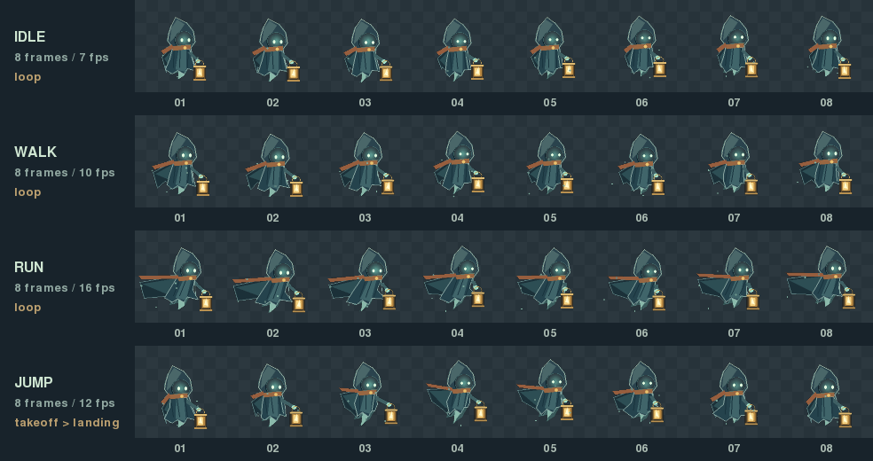

# Cloaked wisp — player sprite sets

Four original, transparent RGBA sprite sheets, **8 frames each / 32 total**.
The wisp has a glowing, hollow hood, a fluttering cloak, floating spirit ribbons
instead of legs, and the existing brass lantern.

| Action | Sheet | Frames | Playback |
|---|---|---:|---|
| Idle | `wisp_idle.png` | 8 | 7 fps loop: hover, breathing glow, cloth and lantern sway |
| Walk | `wisp_walk.png` | 8 | 10 fps loop: soft glide, shorter cloth wake |
| Run | `wisp_run.png` | 8 | 16 fps loop: forward lean, streaming cape and scarf |
| Jump | `wisp_jump.png` | 8 | Non-looping takeoff → ascent → apex → descent → landing |



Each sheet is **832 × 104 px**, one horizontal row of **104 × 104 px** cells,
facing right. `manifest.json` supplies each frame rectangle, timings and pivots.
The pivot is `(52, 68)`; after horizontal mirroring it is `(51, 68)`. The fixed
pivot prevents direction changes or pose changes from shifting the player.

The live game and these exports use the same deterministic, cached vector
frames from `nur_game/wisp.py`, supersampled at 2× for clean edges. PNGs are
exports for inspection/reuse, not a second independently maintained source.

Regenerate from `v3`:

```bash
.venv-echo/bin/python -m nur_game.generate_wisp
```

Animation selection does **not** modify gameplay speed or add a sprint key:
idle below 12 px/s, walk below 150 px/s (including crate pulling), run at full
travel speed. Jump frames follow actual vertical velocity and do not loop in
midair. Playback pauses with the game and resets on room retry/new game.
Collision size, movement, lantern protection and environment artwork are unchanged.
