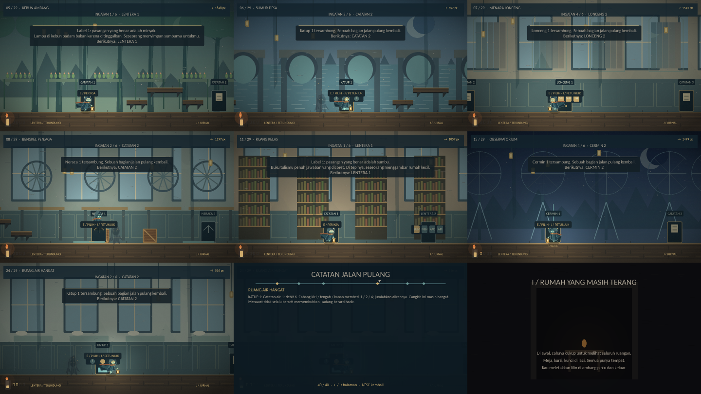

# Campaign playtest: from a short slice to a longer journey

## Result and method

| Run | Completed | Simulated gameplay | Added reading delays | Deaths |
|---|---|---:|---:|---:|
| Original five-room slice | Yes | **45.825 s** | None | 0 |
| Expanded 29-room campaign | Yes | **1,168.275 s — 19:28** | None | 0 |

- [Original input-only report](baseline-playtest.json)
- [Expanded input-only report, with per-chapter times](playtest.json)

The pilot supplies ordinary `Input` controls to the same 120 Hz Pymunk simulation
used by the game. It does not teleport, change movement speed, edit quest state,
disable collisions or skip rooms. It knows device answers in advance. It moves
at the game's normal maximum speed and releases E between button presses.
The expanded run completes **144 quest steps: 72 clue inspections and 72 device
puzzles**, plus the original traversal and final echo/mercy sequence.

This is **accelerated scripted play**, not nineteen minutes of human wall-clock
play. Execution time is recorded separately. Journal screenshots briefly open
the real UI without advancing simulated time; no reading time or ending slideshow
time is added to the reported duration. A pilot stall fails the run rather than
being treated as extra content.

## Analysis and changes

The old slice was traversable, but its four small exploration rooms and brief
boss offered far too little content for fifteen minutes. Lantern immunity also
made the old monster encounters atmosphere rather than meaningful obstacles.
Making enemies damaging again would violate the protection requirement.

The expansion adds:

- Four new story acts: village → archives → forest → care → return home.
- Twenty-four short chapters and ten environment styles, with different room
  arrangements, raised routes and chapter-specific scenery.
- Six recurring puzzle families: matching lantern components, weighted valve
  branches, note sequences, physical crate scales, mirror orientation and
  independent circuit switches. They are variations of six mechanics, **not
  seventy-two wholly new mechanics**.
- Persistent clues, a paginated journal/map, contextual interaction prompts,
  local button selection and a visible current objective.
- Puzzle checkpoints and resume, so a longer session need not be completed in
  one sitting. An unfinished crate placement or boss phase resets on resume;
  solved chapter tasks, memories and clues remain saved.
- Slower time-based light decay and more widely spaced major memories, keeping
  visibility loss relevant across the longer story. Empty lanterns still protect
  against every monster; physical blades and falls remain dangerous.

The duration target is met by this tested route, without a fifteen-minute timer
or required idle waits. It is not a proof of the fastest possible speedrun.
The known-solution run spends approximately **4:57 in the village**, **4:24 in
the archives**, **4:27 in the forest**, and **4:55 in the care act**. The opening
and boss still take only about 35 and 11 seconds respectively; most of the new
session is the journey, not an artificially prolonged finale.
Human playtesting is still needed to assess puzzle discovery, readability,
repetition and enjoyment. Several chapters reuse collection/delivery trips; that
is the main pacing risk to watch in a first-time playtest.

### Suggested first-time human check

Play from home for at least fifteen minutes without using the pilot or looking
at puzzle targets in the source. Check whether:

1. The crate and rope controls are discoverable in the opening rooms.
2. The first village clue explains how to choose a physical lantern slot.
3. Valve values, note order and mirror direction remain understandable when mute.
4. J opens useful recent clues, and returning from the journal is unambiguous.
5. Travel between stations feels purposeful rather than repetitive.
6. Pausing/quitting and continuing preserves solved tasks and doesn't refill light.

If repetition dominates, the next improvement should be fewer delivery loops
and deeper combinations of existing devices—not longer corridors or slower
movement. Report actual first-time completion time separately from the pilot.

## Actual gameplay captures



These screenshots come from the completed run, not manually staged player
positions or selected lantern charges. Full-resolution examples:

- [Garden and first clue](journey/chapter-05.png)
- [Valve branches](journey/chapter-06.png)
- [Musical buttons](journey/chapter-07.png)
- [Physical crate scale](journey/chapter-08.png)
- [Archive classroom](journey/chapter-11.png)
- [Observatory mirror](journey/chapter-15.png)
- [Care chapter](journey/chapter-24.png)
- [Journal](journey/journal.png)

## Reproduce

From `v3`:

```bash
PYTHONPATH=. .venv-echo/bin/python scripts/playtest_nur.py \
  --output docs/nur/verification/playtest.json \
  --captures docs/nur/verification/journey
```

The pilot uses `persist=False` and does not touch the player's save file.
Automated checks are documented in [README.md](README.md), including separate
input-only checks for every new chapter at zero lantern charge.

To play yourself:

```bash
.venv-echo/bin/python play_nur.py
# Return later:
.venv-echo/bin/python play_nur.py --continue
```

Use **J** for the journal, **E** beside a component/switch/note to select it,
and hold **E** to move crates. Lantern protection stays active throughout.
