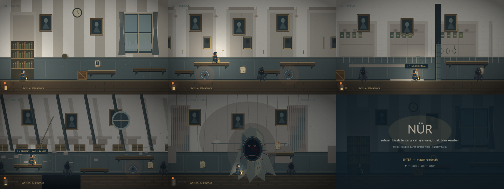

# NÜR campaign, artwork and lantern fairness verification

## Automated checks

```bash
# From v3
.venv-echo/bin/python -m pytest -q \
  tests_nur \
  tests_echo/test_physics.py tests_echo/test_game.py \
  tests_echo/test_seesaw.py tests_echo/test_magnet.py tests_echo/test_assets.py
```

Campaign verification also covers all 24 new chapters, local puzzle inputs,
checkpoint migration/resume, journal playback and the full duration test.
Latest result: **165 passed** (101 NÜR checks, 64 selected ECHO regression checks).
This is not a claim that the full procedural ECHO suite was run.

- Lantern protection at full, half, near-empty and zero charge.
- Immediate cancellation of a shadow lunge; visible retreat without damage.
- Boss neither fires nor hits while the lantern is carried.
- Memory candle requires a nearby interaction and cannot be reused after retry.
- Holding E grabs; W climbs a rope without accidentally releasing it.
- Closed gates block rather than kill; visuals follow the actual gate fraction.
- Empty lanterns are not refilled by death.
- Cached animated artwork and soft, bounded radial lighting.
- Four distinct wisp animation sets, eight unique transparent frames each;
  loop timing, velocity-driven jump progression, mirroring, paused playback,
  pose resets and pixel-for-pixel agreement between exports and live frames.
- Input-only traversal through the four exploration rooms and the final
  echo/mercy sequence at zero charge. Tests use the live fixed-step physics,
  without teleporting the player or modifying physics to reach the goal.
- Individual input-only traversal of every new chapter with an empty lantern.
- Full 29-room campaign: **19:28 simulated gameplay**, 144 quest steps, zero
  deaths and no reading delays. [Analysis, method and reports](PLAYTEST.md).
- Wrong/remote interactions cannot complete tasks; held E cannot auto-repeat.
- Melodies, independent switch combinations, matching slots and physical scales.
- Saved clues and completed puzzle stages survive checkpoint resume; corrupt
  saves are rejected without mutating the current game.
- Journal pauses simulation/light decay and opens to recent entries.
- Background cache is bounded to six rooms throughout the longer campaign.

## Artwork preview



The contact sheet above records the earlier environment-polish pass. The player
has since been replaced with the cloaked wisp; environment art is unchanged.
Current previews:

- [Actual expanded campaign captures](journey/journey.png)

- [All 32 wisp frames](../../../assets/nur/sprites/wisp/preview.png)
- [Wisp in the live game](wisp-in-game.png)
- [Sprite layout and regeneration](../../../assets/nur/sprites/wisp/README.md)

Regenerate with:

```bash
PYTHONPATH=. .venv-echo/bin/python scripts/capture_nur_polish.py
```

These are **staged artwork previews** with manually selected cameras, player
positions and charge values, not recordings of the traversal tests. `render.json`
contains those values and a local warmed rendering-only timing sample. That
sample excludes simulation, input and window presentation; it is not a measured
gameplay FPS guarantee.
